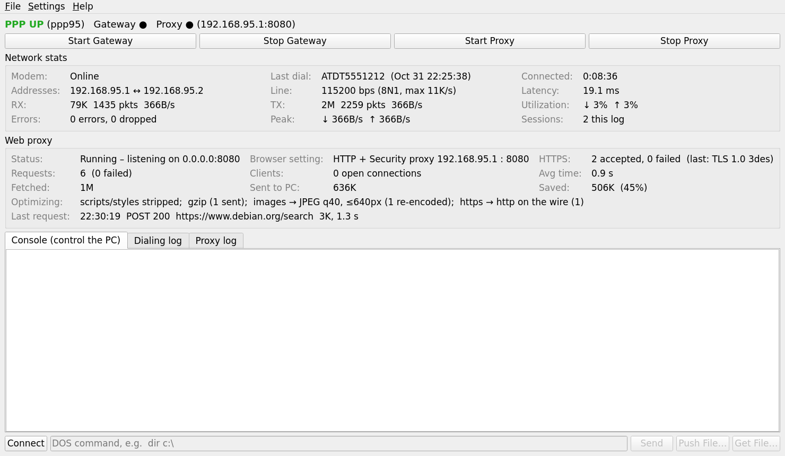

# Retro Dial-Up Gateway

Put a Windows 95, 98, ME, 2000 or XP PC on the modern internet over a serial
cable, and control it from Linux while it browses.

The Linux machine pretends to be a dial-up modem and ISP. The old PC "dials"
with its normal Dial-Up Networking. The gateway answers, starts PPP, and
shares the Linux machine's internet connection. Both machines are then on the
same IP link, so a tiny remote-control program on the old PC (`SERSHTCP.EXE`)
lets you run DOS commands and copy files from Linux while the PC is online.

```
 Windows 9x/2000/XP ──serial cable── Linux ──NAT── internet
   192.168.95.2        (PPP)        192.168.95.1
     ├─ browser ──> retro web proxy :8080 (HTTPS both ways, gzip, smaller images)
     └─ SERSHTCP.EXE :2323 <── control panel / retrogw-ctl
```



## What you need

- A Linux machine with systemd (Debian, Ubuntu, Fedora, Arch, openSUSE…).
- A USB-to-serial adapter on the Linux side and a **null-modem** cable to the
  old PC's COM port (plus a gender changer if needed).

## Install (Linux)

```sh
git clone https://github.com/dfrederick15/retro-dialup-gateway.git
cd retro-dialup-gateway
sudo ./install.sh
```

The installer:

- installs the dependencies (python3, pyserial, PyQt5, ppp, lrzsz, nftables);
- copies the program to `/opt/retrogw`;
- creates `/etc/retrogw/retrogw.conf`, guessing the serial port;
- installs and starts two services, `retrogw-gateway` and `retrogw-proxy`;
- adds you to the `retrogw` group, so the control panel can start and stop the services without a password.

**Log out and back in** after installing so the new group membership applies.

Then open **Retro Dial-Up Gateway** from the app menu (or run `retrogw`) and
check **Settings → Settings…**: pick the serial port (the `/dev/serial/by-id/…`
entry for your adapter is best) and save.

Options: `--no-deps` (skip the package manager), `--no-start` (install
without starting). Remove with `sudo ./uninstall.sh` (`--purge` also deletes
the config).

## Setting up the vintage PC

The Windows programs are in [`windows/bin`](windows/bin), and the installer also
copies them to `/opt/retrogw/windows`. One set of files runs on Windows 95, 98,
ME, NT 4, 2000 and XP:

| File | What it does |
|---|---|
| `SERSHTCP.EXE` | Remote control over the dial-up link (run `SERSHTCP /install` once to start it at every logon) |
| `SERSHELL.EXE` | Remote control over the bare serial cable when not dialed in (`SERSHELL COM1 115200`) |
| `REBOOT.EXE`   | Forces an immediate restart |
| `KILL.EXE`     | Lists or ends programs, since 9x has no `taskkill` (`KILL /L`, `KILL NAME.EXE`, `KILL 0xPID`) |

Step-by-step instructions for each Windows version (installing the modem
driver, creating the dial-up connection and setting the browser proxy) are in
[`windows/README.txt`](windows/README.txt). In short:

1. Add a **Standard 33600 bps Modem** on the COM port and set its maximum speed to 115200.
2. Create a dial-up connection with any phone number and any user name.
3. Dial. The PC gets `192.168.95.2`; test with `ping 192.168.95.1`.
4. For the web, set the browser's HTTP proxy **and** Security (SSL) proxy to `192.168.95.1:8080`.
5. For `https://` sites, open `http://192.168.95.1:8080/` on the PC and install the certificate (see below).

## Updating

Linux: `git pull && sudo ./install.sh --no-deps`. The proxy restarts; the
gateway restarts only if no PC is dialed in.

Vintage PC, while dialed in (Windows can't replace a running EXE, so the new
copy runs on a side port first):

```sh
retrogw-ctl put /opt/retrogw/windows/SERSHTCP.EXE C:\RETROGW\NEW.EXE
retrogw-ctl put /opt/retrogw/windows/KILL.EXE C:\RETROGW\KILL.EXE
retrogw-ctl "start /m C:\RETROGW\NEW.EXE /port 2324"
retrogw-ctl -p 2324 "C:\RETROGW\KILL.EXE C:\RETROGW\SERSHTCP.EXE"
retrogw-ctl -p 2324 "copy C:\RETROGW\NEW.EXE C:\RETROGW\SERSHTCP.EXE"
retrogw-ctl -p 2324 "start /m C:\RETROGW\SERSHTCP.EXE /hide"
retrogw-ctl "C:\RETROGW\KILL.EXE C:\RETROGW\NEW.EXE"
```

## Web proxy

The proxy does the modern-web work so the old PC doesn't have to:

- **HTTPS to the site.** Every page is fetched over HTTPS when the site has
  it (certificate checked), falling back to plain HTTP. Links are rewritten
  to `http://` so browsing stays in the proxy.
- **HTTPS from the old browser.** Windows 9x browsers only know SSL 3.0/TLS 1.0
  with RC4 or 3DES, which modern OpenSSL has removed. The proxy terminates those
  connections itself using the bundled pure-Python
  [tlslite-ng](https://github.com/tlsfuzzer/tlslite-ng), with SSL 3.0 to TLS 1.2,
  RC4, 3DES and AES, and old SSLv2-format hellos. It presents a certificate for each site from a local
  certificate authority made just for your gateway (SHA-1 signed, valid
  2000–2049, so old PCs and wrong clocks accept it). By default it then
  redirects the page to `http://`, so **plain HTTP crosses the serial line**
  instead of encryption the 486 has to grind through. Form posts stay inside
  TLS so nothing is lost.
- **Compression.** Pages are gzipped for browsers that send
  `Accept-Encoding: gzip` (Wikipedia: 551 KB → 83 KB). Images are re-encoded
  as baseline JPEGs at quality 40 and at most 640 px wide, which also makes
  WebP viewable on old browsers (a 225 KB PNG became 11 KB). Windows 95 refuses
  PPP-level compression (it only offers Microsoft's MPPC/STAC, which Linux
  `pppd` lacks), so this is where the savings come from. VJ TCP/IP header compression is on.

**Installing the certificate on the PC:** browse to `http://192.168.95.1:8080/`
(the proxy's own page) and click *download the certificate*. Netscape 4 asks
to accept a new certificate authority. Tick "accept for web sites". Internet
Explorer opens the certificate. Choose *Install Certificate*. Check the
fingerprint on the page against the control panel (hover over **HTTPS**). The
CA lives in `/var/lib/private/retrogw-proxy` and is unique to your gateway.

## Control panel

- **Gateway / Proxy** start and stop buttons, with a live status line.
- **Network stats**: modem state, last dial, connection time, addresses, latency, RX/TX bytes, packets and speed, line utilization, peaks and errors.
- **Dialing log**: the modem's AT command exchange and the PPP setup, as they happen.
- **Web proxy**: status, the browser setting to use, HTTPS handshakes (with the SSL/TLS version and cipher), requests and failures, open connections, average fetch time, data fetched vs. sent to the PC and how much was saved, what's being optimized (gzip, images, https → http), and the last URL. The **Proxy log** tab lists every request.
- **Console**: run commands on the PC, and push or get files.
- **Settings menu**: serial port, speed, IP addresses, DNS, which interface to share internet from, the PPP interface, proxy options and the control port.

## Command line

```sh
retrogw-ctl "dir c:\"                 # run a command on the dialed-in PC
retrogw-ctl put game.zip C:\GAME.ZIP  # push a file
retrogw-ctl get C:\AUTOEXEC.BAT       # pull a file
retrogw-ctl                           # interactive
retrogw-serial "ver"                  # same over bare serial (SERSHELL.EXE, not dialed in)
journalctl -u retrogw-gateway -f      # dialing / PPP log
journalctl -u retrogw-proxy -f        # web proxy requests
```

## Configuration

`/etc/retrogw/retrogw.conf` (editable by members of the `retrogw` group):

| Key | Default | Meaning |
|---|---|---|
| `SERIAL_PORT` | `/dev/ttyUSB0` | Serial device for the cable |
| `BAUD` | `115200` | Line speed; match the modem speed on the PC |
| `LOCAL_IP` / `REMOTE_IP` | `192.168.95.1` / `.2` | PPP link addresses |
| `DNS1` / `DNS2` | `1.1.1.1` / `8.8.8.8` | DNS servers handed to the PC |
| `UPLINK` | *(empty)* | Interface to share internet from; empty = default route |
| `PPP_UNIT` | `95` | PPP interface becomes `ppp95` |
| `PROXY_PORT` | `8080` | Retro web proxy port |
| `PROXY_STRIP_SCRIPTS` | `1` | Remove scripts/styles from pages |
| `PROXY_TLS` | `1` | Accept `https://` from the old browser (needs the CA installed) |
| `PROXY_TLS_TO_HTTP` | `1` | After the handshake, redirect page loads to `http://` (plain HTTP on the wire) |
| `PROXY_COMPRESS` | `1` | gzip text for browsers that accept it |
| `PROXY_IMAGE_QUALITY` | `40` | Re-encode images as JPEG at this quality (`0` = off) |
| `PROXY_IMAGE_MAX_WIDTH` | `640` | Shrink wider images (`0` = no limit) |
| `CONTROL_PORT` | `2323` | Port of `SERSHTCP.EXE` on the PC |

Restart the services after editing by hand: `sudo systemctl restart retrogw-gateway retrogw-proxy`.
The Settings dialog can restart them for you.

## Building the Windows programs

```sh
sudo apt install gcc-mingw-w64-i686     # Fedora: mingw32-gcc
make -C windows/src check
```

The programs are built freestanding (no C runtime) for the 486 and PE
subsystem 4.0. They import only KERNEL32, USER32, ADVAPI32 and WSOCK32
functions that exist on Windows 95, which is why one file runs on every
version up to XP. `make check` verifies the subsystem version, the imported
DLLs and that no Pentium Pro-only instructions slipped in.

## Troubleshooting

- **No response when dialing.** Check that the serial port in Settings is
  right (the Dialing log shows `waiting for dial on …`) and that the speeds
  match. Use a null-modem cable, not a straight one.
- **Dialing is flaky right after plugging in.** ModemManager may be probing
  the port: `sudo systemctl disable --now ModemManager`.
- **The PC connects but has no internet.** Check the `UPLINK` setting. With
  firewalld, allow forwarding or add the PPP interface to a trusted zone.
- **The Connect button fails.** `SERSHTCP.EXE` isn't running on the PC (run
  `C:\SERSHTCP.EXE /hide`), or its `/allow` address doesn't match `LOCAL_IP`.
- **Overruns or garbled PPP at 115200.** Drop to 57600 on both ends; the link
  has no hardware flow control.

## Security

The PPP link has no authentication, and `SERSHTCP` / `SERSHELL` have no
password. `SERSHTCP` accepts connections only from the gateway's address by
default. Use this on a direct cable between machines you own.

The web proxy listens on all interfaces, so other machines on your LAN can use
it too; firewall port 8080 if that matters. Its certificate authority can
impersonate any site to a PC that trusts it: only install it on the vintage
PC, and keep `/var/lib/private/retrogw-proxy/ca.key` private (`uninstall.sh
--purge` deletes it). Old SSL 3.0/RC4 is weak, which is acceptable only
because that leg is the serial cable; the internet side always uses modern TLS.

## License

MIT
